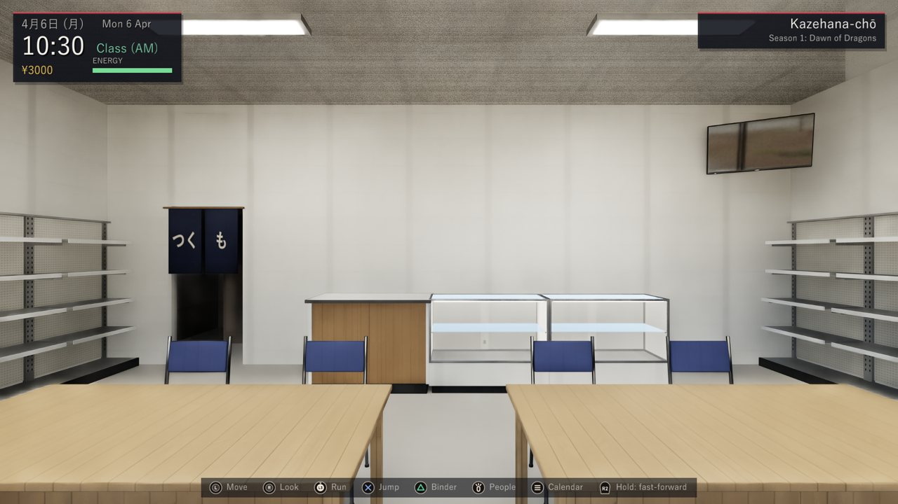
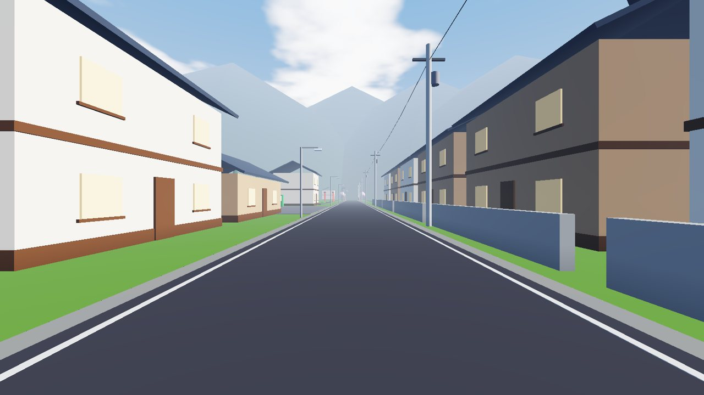
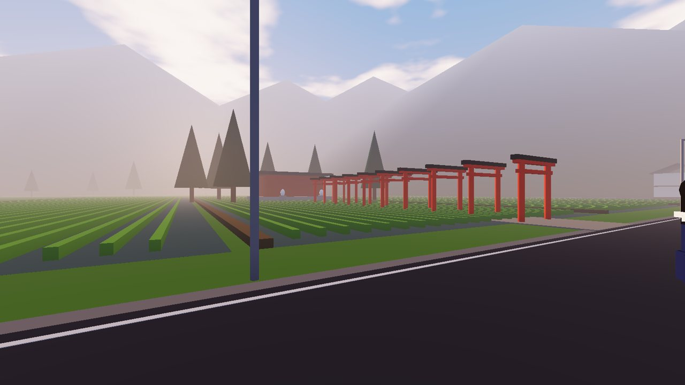
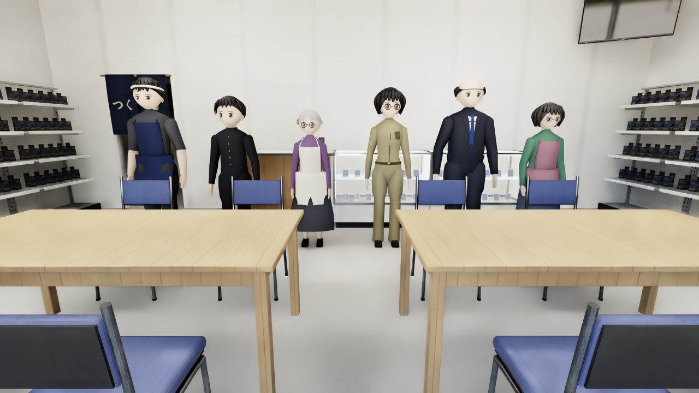
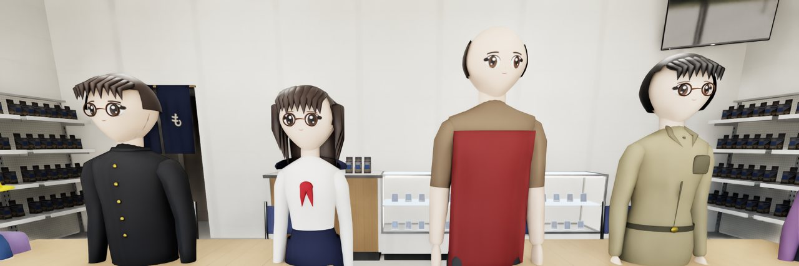
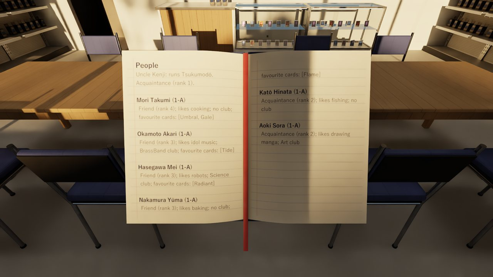
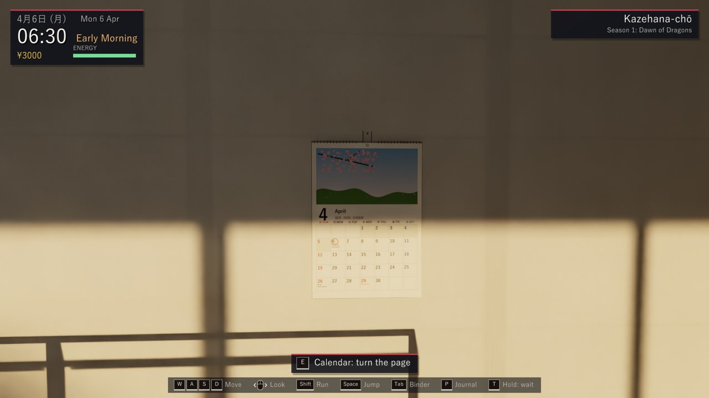
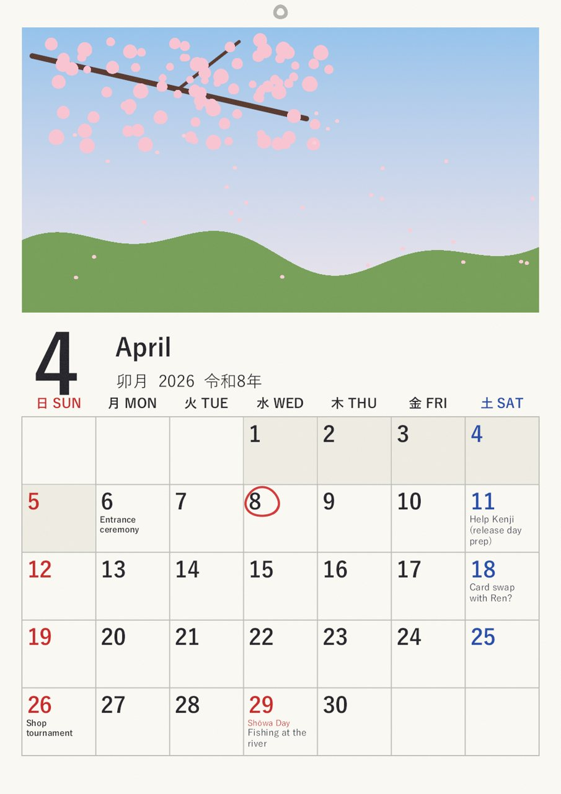
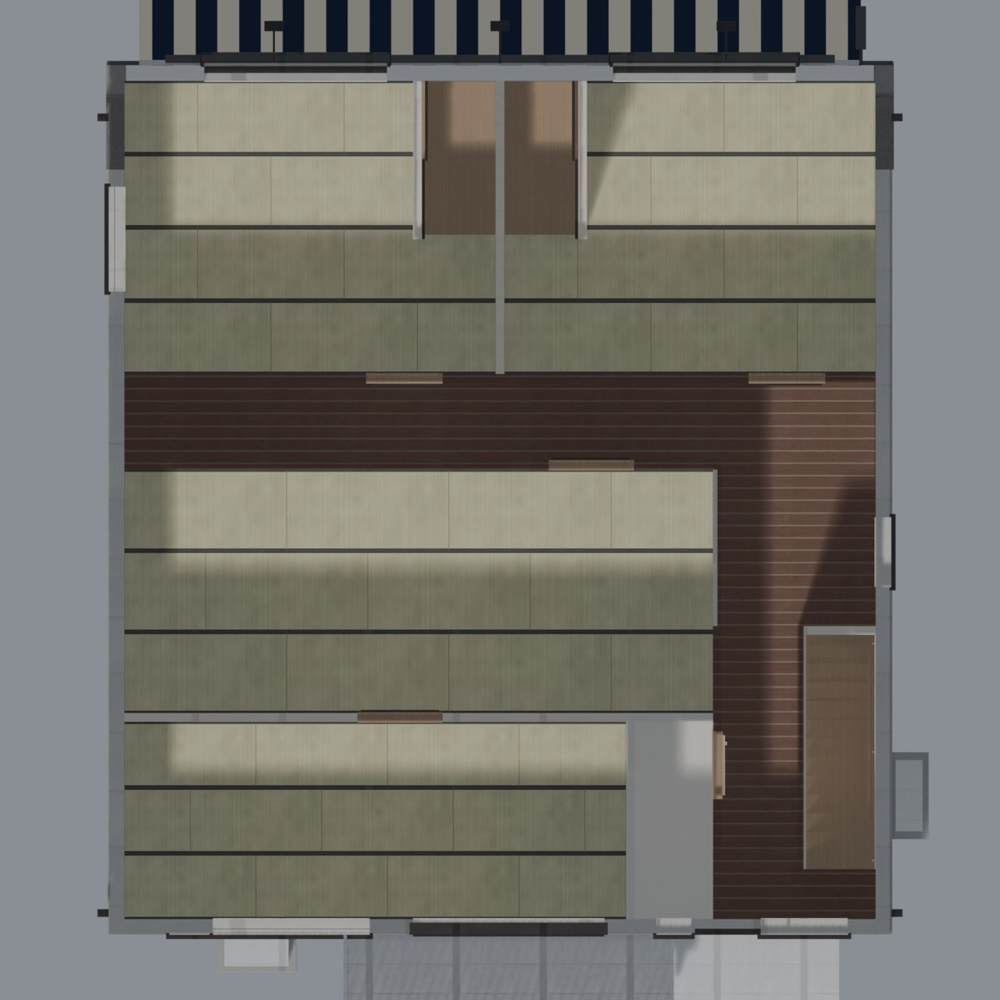
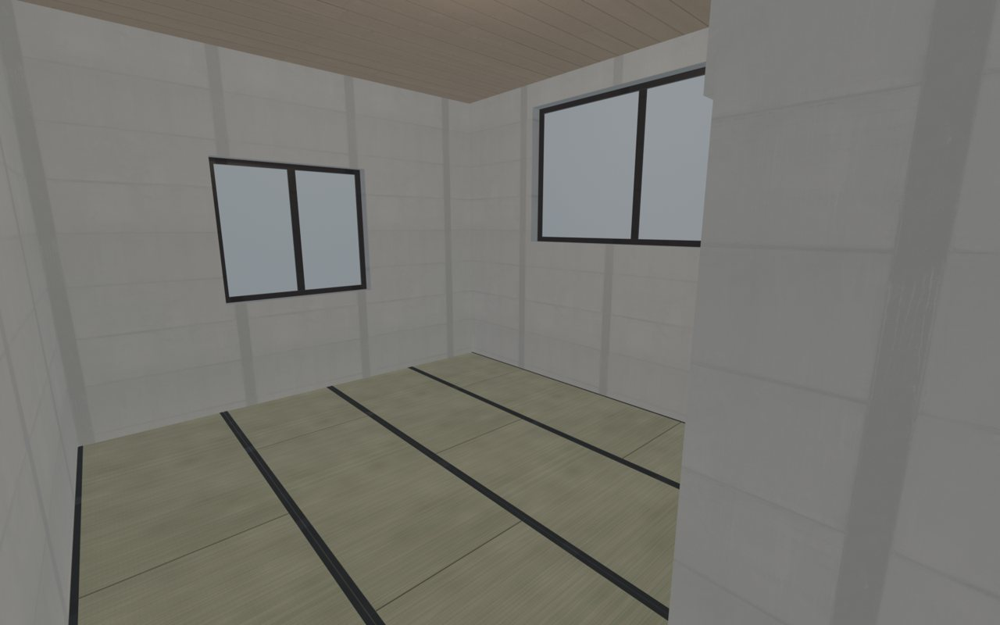

# Kazehana

A slice-of-life game set in a small rural town in Japan. You're a 12-year-old who has come to live with Uncle Kenji above his trading card shop, **Tsukumodō**. You go to school and help in the shop, and you trade cards with everyone in town. Time only skips when you sleep, and you plan your days on the calendar in your room.

It is written from scratch in Rust, on its own hardware ray-traced Vulkan engine, **Akari**.



> **Status:** early development. The town, the people, the life simulation and the shop are being built piece by piece, and the art in these shots is work in progress.

## What's in it

**A town that's lived in.** Kazehana-chō is generated from a town plan, with terrain, roads, a river, a railway, rice paddies and houses. The **census** gives all 1,392 residents a name, a household, a family and relatives, a job or a school, friend groups and clubs, and a daily routine.





**Everyone is someone.** Every resident is an anime-style character built in Blender from their census entry, with their own age, height, hair, clothes and accessories.





**No menus for information.** What you know lives on things in the world, not in a menu:
- your journal, with its diary, the people you've met and what they've asked of you;
- the wall calendar, with holidays, school events and your plans.

The game draws their pages from the game state and shows them on the objects themselves.



| The calendar on the shop wall | A month's page |
|---|---|
|  |  |

**Your days are yours.** Time runs minute by minute. Classes, meals, shifts at the counter, reading, studying and baths all take time. The day only jumps forward when you sleep, and hunger, energy and spoiling food keep going in between.

**Home.** Tsukumodō is a two-storey Shōwa-era shophouse:
- **Ground floor:** the shop at the front, with the kitchen, bath, stockroom, genkan and stairs behind it.
- **Upstairs:** tatami rooms for you and Kenji, a living room, and a balcony.

| Upstairs plan | Your room (not furnished yet) |
|---|---|
|  |  |

## The code

A Cargo workspace:

| Crate | What it is |
|---|---|
| [`crates/akari`](crates/akari) | The renderer: Vulkan hardware ray tracing (path tracing), DLSS Ray Reconstruction or TAA, glTF models |
| [`crates/game`](crates/game) | The game itself (binary `kazehana`) |
| [`crates/sim`](crates/sim) | The life simulation: calendar, clock, activities, meals, items, bonds, the economy and saves. Deterministic and unit-tested |
| [`crates/census`](crates/census) | The town's population database: households, families, jobs, schools, groups and schedules |
| [`crates/town`](crates/town) | The town from its plan: terrain, roads, bridges, plots and collision |
| [`crates/play`](crates/play) | Playing in the world: input (keyboard and mouse, PlayStation and other controllers), collision, the first-person controller, doors, cloth |
| [`crates/anim`](crates/anim) | Skeletal animation |
| [`crates/pages`](crates/pages) | Paper in the world: the calendar and journal pages, drawn from the game state |
| [`crates/tcg`](crates/tcg) | The trading card game's cards, sets, packs and collections |
| [`crates/assets`](crates/assets) | The asset quality gate and approval registry |
| [`tools/`](tools) | Blender build scripts for buildings, props and people, `townview`, `assetcheck`, and card generation |

Design documents are in [`docs/`](docs), for example [`GAME_DESIGN.md`](docs/GAME_DESIGN.md), [`life_plan.md`](docs/life_plan.md), [`home_plan.md`](docs/home_plan.md), [`population_plan.md`](docs/population_plan.md) and [`ENGINE_PLAN.md`](docs/ENGINE_PLAN.md).

## Building

You need:
- Rust (stable);
- the Vulkan SDK (for `glslangValidator`);
- a GPU with hardware ray tracing (Vulkan ray tracing pipeline).

To build and run:

```sh
cargo run --release -p kazehana
```

To run the tests:

```sh
cargo test --release
```

DLSS Ray Reconstruction is optional. To enable it, set `DLSS_SDK` to the NVIDIA DLSS SDK. The SDK and its runtime belong to NVIDIA and are not part of this repository.

### Assets

This repository holds the code, the tools and the data (JSON). It does **not** hold the 3D models and textures. Most are built from Fab / Quixel Megascans downloads, whose licence doesn't allow redistributing them, and the rest are large generated outputs.

They are rebuilt with the scripts in [`tools/blender`](tools/blender) (Blender 5.2) and checked by `assetcheck` ([`docs/ASSET_QUALITY.md`](docs/ASSET_QUALITY.md)). [`docs/FAB_ASSETS.md`](docs/FAB_ASSETS.md) lists the Fab assets the scripts expect. Without them the game still builds and the simulation tests (`sim`, `census`, `pages`) run, but the world will be mostly empty.

## License

The code, tools, docs and data in this repository are under the [MIT License](LICENSE). Third-party content they work with (Fab / Megascans assets, the NVIDIA DLSS SDK and runtime) stays under its own licence and is not included.
