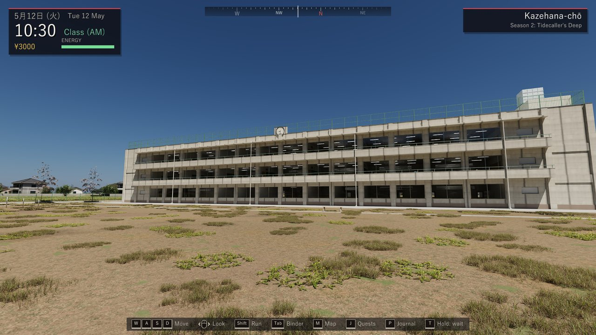
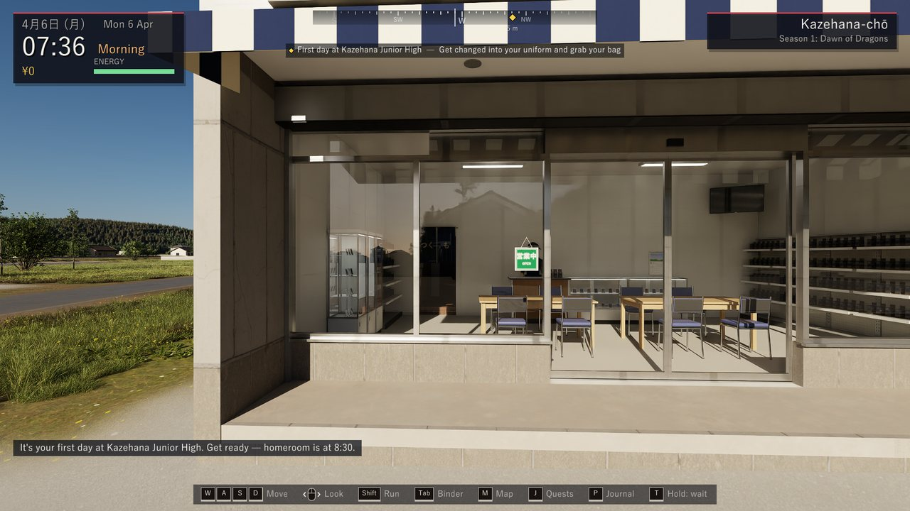
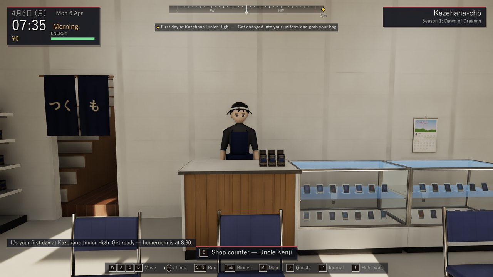
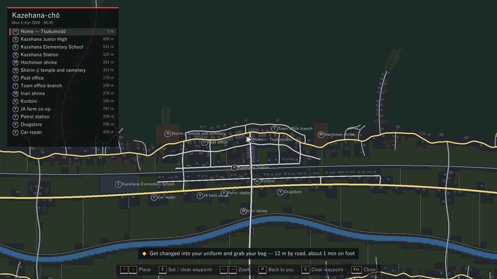
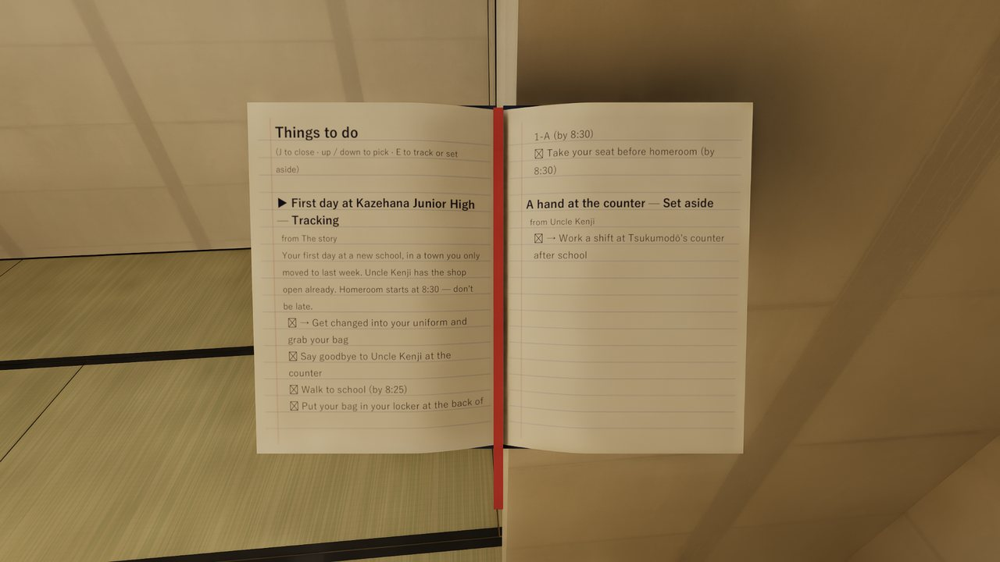
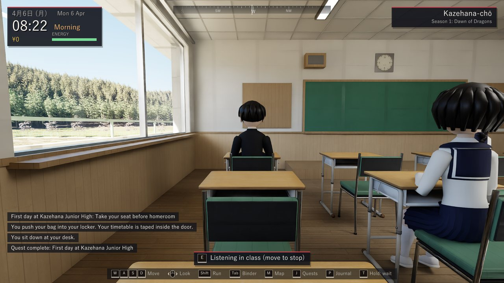
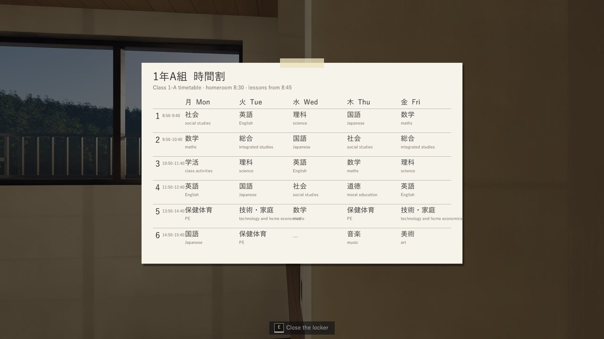
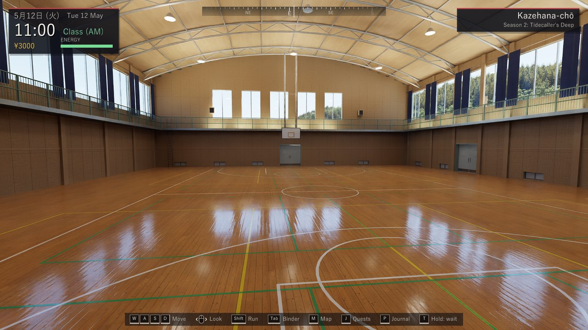
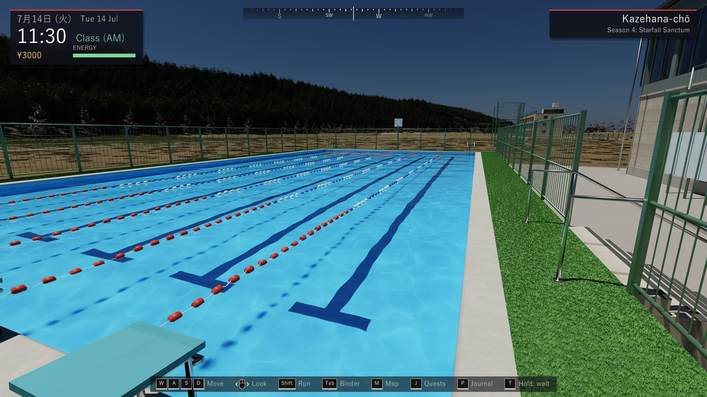

# Kazehana

**A slice-of-life game about one school year in a small Japanese town, a trading-card shop, and the people you meet.**

You are twelve, and you've just moved to Kazehana-chō to live with your Uncle Kenji above his card shop, **Tsukumodō**. The game lasts exactly one school year, from the first day of term on 6 April 2026 to the closing ceremony in March 2027. You go to school, help behind the counter, and trade cards with a town where every resident has a name, a family and a day of their own.

Kazehana is written from scratch in Rust on **Akari**, its own Vulkan engine, which path-traces every frame with hardware ray tracing.



> **Status:** in active development. The first school morning plays from start to finish. The art shown here is in-engine and still being refined.

---

## Contents

- [The game](#the-game)
- [The first morning](#the-first-morning)
- [The town and its people](#the-town-and-its-people)
- [School](#school)
- [Rendering](#rendering)
- [Project layout](#project-layout)
- [Building and running](#building-and-running)
- [Assets](#assets)
- [License](#license)

---

## The game

**One year, minute by minute.** The clock never jumps except when you sleep:
- classes, meals, shifts at the counter, reading, studying and baths all take real time;
- hunger and energy carry on in between;
- the calendar follows Japan's real school year, with its public holidays, substitute holidays, and spring, summer and winter breaks.

**A town that keeps its own schedule.** All 1,832 residents come from one census:
- each has a household, a job or a school, friends and clubs;
- each follows a daily routine;
- the 99 junior-high students each have their own body clock and their own walk to school, so they arrive at different times each morning, and a few run late on a bad day.

**Information lives on things.** Wherever possible you don't read menus:
- your journal holds the diary, the people you've met and the things you've set out to do;
- the wall calendar in the shop shows the month;
- your class timetable is taped inside your locker door.

**The card shop.** Tsukumodō sells booster packs and singles. You can buy packs, work shifts for Uncle Kenji, and sell cards to classmates who value them differently. The town remembers whether you dealt fairly.

| The shop at opening time | Uncle Kenji at the counter |
|---|---|
|  |  |

## The first morning

The game opens on the first day of school, 6:45 a.m., in your room above the shop, with no money of your own.

1. Get changed into your uniform and pick up your bag.
2. Go downstairs and say *ittekimasu* to Uncle Kenji. He has already opened the shop, and the sign in the window says 営業中 (open).
3. Walk to school. The **map** (M) shows the way by road, and the **compass** shows where the next step lies.
4. Put your bag in your locker at the back of class 1-A.
5. Take your seat before homeroom at 8:30, as your classmates drift in.

**Quests** are kept in your journal (J). Each one can be tracked or set aside, and the tracked quest drives the compass and the map's waypoint. On the map you can also pin any place in town and get a route to it.

| The map | Quests in the journal |
|---|---|
|  |  |

## The town and its people

Kazehana-chō is generated from a town plan into terrain, roads, a river with levees, a railway and its station, rice paddies, vegetable plots and 471 houses on their own plots, with 343,000 trees across the hills. Every resident is an anime-style character built in Blender from their census entry: their age, height, hair, uniform or work clothes. Characters are still in review.


## School

Kazehana Junior High is built as a whole site:
- **Main building:** three storeys of classrooms, the staff room, special rooms and toilets.
- **Gym:** a hall with a stage, a gallery and painted court lines.
- **Outdoor pool:** 25 m, with lane ropes that float on the water.
- **Grounds:** the sports ground, gate, fence, bike shed and flagpoles.

The timetable comes from the census staff, and the bells ring on a real junior-high day. Once you're inside the school you stay until it's out, unless you raise your hand to ask for the toilet. Lessons cover Year 7's subjects for the whole year and happen at your desk in the classroom, on paper: worksheets, notebooks, tests and report cards.

| Class 1-A before homeroom | Your timetable |
|---|---|
|  |  |

| The gym | The pool |
|---|---|
|  |  |

## Rendering

Akari is a Vulkan hardware path tracer with optional DLSS Ray Reconstruction, and TAA otherwise. Notable features:
- **Ground:** land-use mapped terrain built from scanned surfaces, without visible tiling.
- **Grass:** a parallax lawn layer of baked real blades, with no added geometry.
- **Plants:** impostors for trees and grass at a distance.
- **Water:** refraction, reflection, depth absorption and caustics, with animated ripples that the floating objects follow.
- **Motion:** correct motion vectors for doors and moving objects.
- **Lighting:** many-light sampling for interiors.
- **Exposure:** a physically based sky with sun and moon, and auto exposure.

Every model passes an automated **quality gate** (`assetcheck`: scale, origin, textures, normals, triangle budgets) and look-dev renders, then a human approval recorded in `assets/registry.json`. The game only loads approved assets; unapproved ones are shown "in review".

## Project layout

A Cargo workspace:

| Crate | Purpose |
|---|---|
| [`crates/akari`](crates/akari) | The renderer: Vulkan ray-traced path tracing, DLSS / TAA, glTF loading, impostors, the lawn layer, water |
| [`crates/game`](crates/game) | The game (binary `kazehana`): exploration, the story, quests, the map and compass, lessons, the shop |
| [`crates/sim`](crates/sim) | The life simulation: calendar and holidays, clock and sky, activities, quests, lessons and marks, economy, saves. Deterministic and unit-tested |
| [`crates/census`](crates/census) | The town's people: households, families, jobs, schools, groups, the school timetable and everyone's daily schedule |
| [`crates/town`](crates/town) | The town from its plan: terrain, roads, plots, buildings, collision, the walkways audit |
| [`crates/play`](crates/play) | Playing in the world: input (keyboard, mouse and controllers), the first-person controller, collision, doors, cloth |
| [`crates/anim`](crates/anim) | Skeletal animation and spring bones |
| [`crates/pages`](crates/pages) | Paper in the world: the journal, the calendar, worksheets and notebooks, drawn from the game state |
| [`crates/tcg`](crates/tcg) | The trading card game: cards, sets, packs and collections |
| [`crates/assets`](crates/assets) | The asset quality gate and approval registry |
| [`tools/`](tools) | Blender build scripts for buildings, props and people, texture generators, `townview`, `assetcheck` and card tools |

Design documents are in [`docs/`](docs), for example [`GAME_DESIGN.md`](docs/GAME_DESIGN.md), [`life_plan.md`](docs/life_plan.md), [`school_plan.md`](docs/school_plan.md), [`lessons_plan.md`](docs/lessons_plan.md), [`population_plan.md`](docs/population_plan.md), [`TOWN_PLAN.md`](docs/TOWN_PLAN.md) and [`ENGINE_PLAN.md`](docs/ENGINE_PLAN.md).

## Building and running

**Requirements**
- Rust (stable)
- The Vulkan SDK (for `glslangValidator`)
- A GPU with hardware ray tracing (the Vulkan ray-tracing pipeline)

**Run the game** from the first morning:

```sh
cargo run --release -p kazehana
```

**Controls:**
- WASD to move, the mouse to look, Shift to run;
- E to interact, M for the map, J for quests, P for the journal, Tab for the card binder;
- hold T to let time pass.

PlayStation and Xbox controllers are supported.

**Tests and checks:**

```sh
cargo test --release                        # unit and integration tests
cargo run --release -p kazehana -- --autoplay  # plays the first morning through, with screenshots
cargo run --release -p townview -- --audit     # checks roads, paths and doorways for obstructions
```

DLSS Ray Reconstruction is optional. To enable it, set `DLSS_SDK` to the NVIDIA DLSS SDK; the SDK and its runtime belong to NVIDIA and are not part of this repository.

## Assets

This repository holds the code, the tools and the data (JSON). It does **not** include the 3D models and textures. Most are built from Fab / Quixel Megascans downloads, whose licence does not allow redistribution, and the rest are large generated outputs.

To rebuild them:
- **Build** with the scripts in [`tools/blender`](tools/blender) (Blender 5.2) and the texture tools in [`tools/`](tools).
- **Check** them with `assetcheck`, as described in [`docs/ASSET_QUALITY.md`](docs/ASSET_QUALITY.md).
- **Fab assets:** [`docs/FAB_ASSETS.md`](docs/FAB_ASSETS.md) lists the ones the scripts expect.

Without the assets, the game still builds and the simulation tests (`sim`, `census`, `pages`) run, but the world is mostly empty.

## License

The code, tools, documentation and data in this repository are released under the [MIT License](LICENSE). Third-party content they work with (Fab / Megascans assets, the NVIDIA DLSS SDK and runtime) remains under its own licence and is not included.
